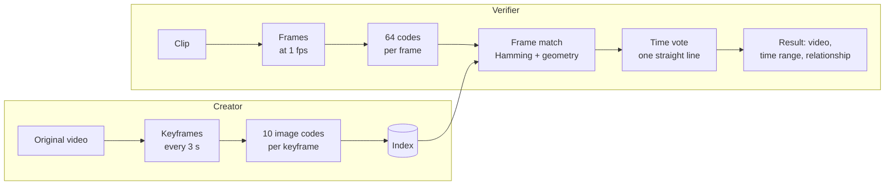

# How matching works, step by step

One NASA launch video (Atlas V TDRS-M, 170 s) is declared. One of test mode's
clips is checked against it: 30 s of the video with a caption bar burned in.
The figures come from [`docs/demo/make.py`](docs/demo/make.py).



## Creator: declaring the video

### 1. Keyframes


ffmpeg decodes the video at 5 fps and finds scene cuts. A keyframe is taken
every 3 s, with these rules:

- **Grid points near a cut are skipped.** A grid point within 0.5 s of a cut
  gives no keyframe, which is why 9 s and 12 s are missing.
- **Blurred frames are swapped.** A blurred grid frame is replaced by the
  sharpest frame within ±0.4 s: 78.4 s stands in for 78 s.
- **Black and uniform frames are dropped.**
- **Near-duplicates are folded.** A keyframe that repeats an earlier one is
  stored only as a time on it: "6.0 s +2 same" stands for two later grid
  points that showed the same picture.

### 2. Image codes on each keyframe


Each keyframe goes through [image-simprints](https://github.com/jmsherrier/image-simprints)
with `generate(frame, "creator", {"creator_codes": 10})`. Each code is 256 bits
and describes one local patch. The circle shows the patch's size, the line its
orientation, and the number its rank (1 is the strongest).

On top of image-simprints' own fields, each code carries its keyframe, time and
scene:

```json
{"code": "214271b6b3240b8e…", "x": 0.188, "y": 0.893, "scale": 0.076, "angle": 89.8,
 "keyframe": 0, "time": 3.0, "scene": 1}
```

### 3. Index

All keyframes of all declarations go into one index. Some codes also show up
in other videos of the same channel: a series intro, a studio set, a logo bug.
You can either leave those out with `shared_after=0`, or keep them marked as
shared with `label=True` (see step 7).

## Verifier: checking a clip

### 4. Frame match


The clip is sampled at 1 fps. Each frame gets up to 64 verifier codes (grey
dots, left).

1. **Candidates:** any keyframe with at least 2 codes within Hamming distance 24
   of the frame's codes (green lines).
2. **Geometric check:** image-simprints' `match()` then checks that those pairs
   agree on one scale, rotation and shift.
3. **Relationship:** the agreeing pairs give the relationship between the two
   pictures. Here it is `identical`, because the caption bar covers only part
   of the picture.

### 5. Time vote


Each frame match is a point: its time in the clip against the keyframe's time
in the original.

- **Static shots match many keyframes.** A long, still shot matches several
  keyframes at once, so one clip time has a column of points (orange).
- **Real copies line up.** A real copy plays at about the original's speed, so
  its points lie on a line `t = a c + b` with slope 1 ± 10%.
- **The line with the most frames wins.** The vote tries each slope through
  each point and keeps the line with the most distinct clip frames within 3 s
  (green). A declaration matches if at least M frames agree.

### 6. Result

```json
{"declaration": "atlas-v", "frames": 21, "relationship": "identical",
 "clip": [8.0, 29.0], "original": [146.82, 169.08], "slope": 1.06,
 "overlap_fraction": {"verifier": 0.995, "candidate": 0.9989}, "shared_fraction": 0.0}
```

21 frames lie on one line. Clip seconds 8–29 correspond to 146.8–169.1 s of the
original. The clip was actually cut from 136.8 s, so the true range is 144.8–165.8 s,
within the 3 s tolerance. The first 8 s of the clip found nothing.

## Two harder cases

### 7. Picture-in-picture: tiles


Here the clip is a 25% inset in the corner of another video. Coded as a whole
frame, the inset is too small: 0 agreeing codes.

With `tiles=5`, the verifier also codes four half-size quarters and one centre
tile (grey boxes). In the bottom-left tile (green) the inset is four times
larger, and the tile matches the keyframe as `contains`: the original's picture
sits inside the clip's.

### 8. Shared branding: labels

Episodes of a series share their intro and studio set, so a clip of one episode
also matches the others there. With `index(..., shared_after=0, against=others,
label=True)`, codes that also appear in other videos of the reference collection
are marked as shared.

A match whose agreeing codes are at least 60% shared comes back as
`shared_branding`, not as a match to that episode. In this example
`shared_fraction` is 0.0, because launch footage is not branding.

To regenerate the figures, run `fetch-corpus` and `test`, then:

```bash
python docs/demo/make.py
```
