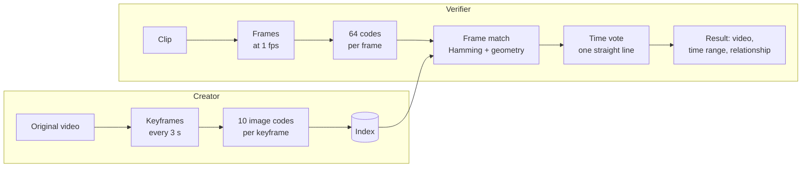
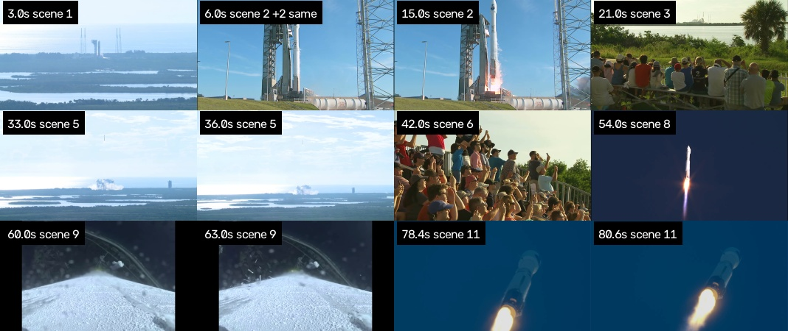
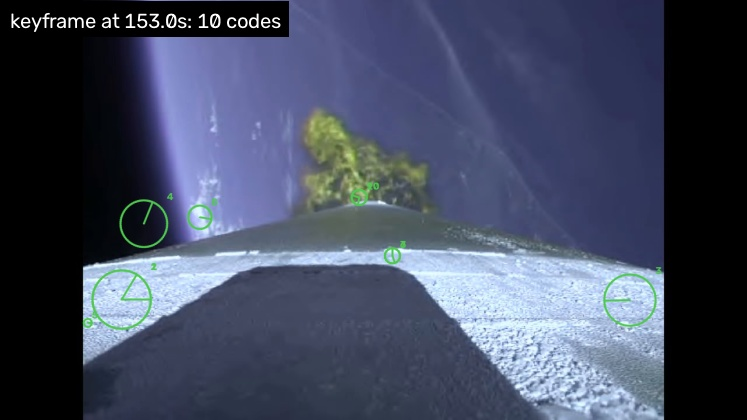
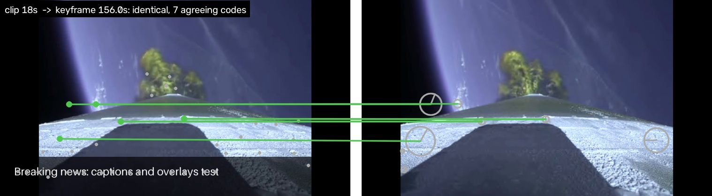
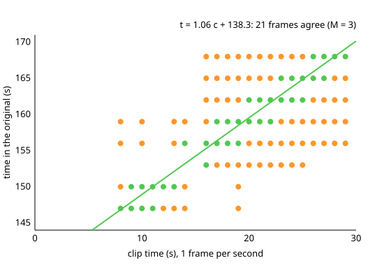
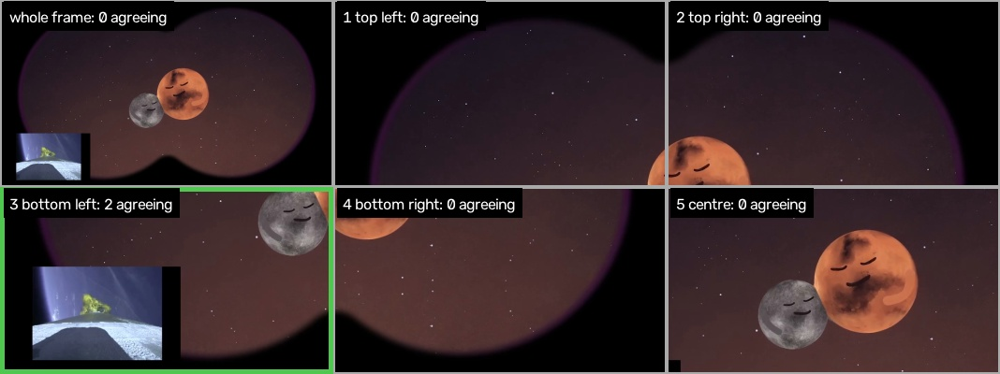
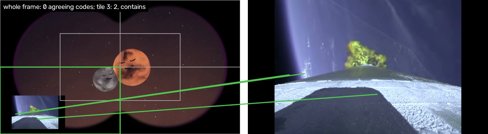
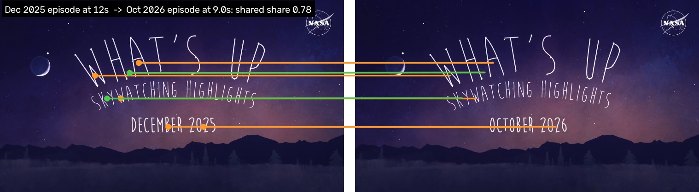

# How matching works, step by step

One NASA launch video (Atlas V TDRS-M, 170 s) is declared. One of test mode's
clips is checked against it: 30 s of the video with a caption bar burned in.
The figures come from [`docs/demo/make.py`](docs/demo/make.py).



## Creator: declaring the video

### 1. Keyframes



ffmpeg decodes the video at 5 fps and finds scene cuts. A keyframe is taken
every 3 s, with these rules:

- **Grid points near a cut are skipped.** A grid point within 0.5 s of a cut
  gives no keyframe, which is why 9 s and 12 s are missing.
- **Blurred frames are swapped.** A blurred grid frame is replaced by the
  sharpest frame within ±0.4 s: 78.4 s stands in for 78 s.
- **Black and uniform frames are dropped.**
- **Near-duplicates are folded.** A keyframe that repeats an earlier one is
  stored only as a time on it: "6.0 s +2 same" stands for two later grid
  points that showed the same picture.

### 2. Image codes on each keyframe



Each keyframe goes through [image-simprints](https://github.com/jmsherrier/image-simprints)
with `generate(frame, "creator", {"creator_codes": 10})`. Each code is 256 bits
and describes one local patch. The circle shows the patch's size, the line its
orientation, and the number its rank (1 is the strongest).

On top of image-simprints' own fields, each code carries its keyframe, time and
scene:

```json
{"code": "214271b6b3240b8e…", "x": 0.188, "y": 0.893, "scale": 0.076, "angle": 89.8,
 "keyframe": 0, "time": 3.0, "scene": 1}
```

### 3. Index

All keyframes of all declarations go into one index. Some codes also show up
in other videos of the same channel: a series intro, a studio set, a logo bug.
You can either leave those out with `shared_after=0`, or keep them marked as
shared with `label=True` (see step 7).

## Verifier: checking a clip

### 4. Frame match



The clip is sampled at 1 fps. Each frame gets up to 64 verifier codes (grey
dots, left).

1. **Candidates:** any keyframe with at least 2 codes within Hamming distance 24
   of the frame's codes (green lines).
2. **Geometric check:** image-simprints' `match()` then checks that those pairs
   agree on one scale, rotation and shift.
3. **Relationship:** the agreeing pairs give the relationship between the two
   pictures. Here it is `identical`, because the caption bar covers only part
   of the picture.

### 5. Time vote



Each frame match is a point: its time in the clip against the keyframe's time
in the original.

- **Static shots match many keyframes.** A long, still shot matches several
  keyframes at once, so one clip time has a column of points (orange).
- **Real copies line up.** A real copy plays at about the original's speed, so
  its points lie on a line `t = a c + b` with slope 1 ± 10%.
- **The line with the most frames wins.** The vote tries each slope through
  each point and keeps the line with the most distinct clip frames within 3 s
  (green). A declaration matches if at least M frames agree.

### 6. Result

```json
{"declaration": "atlas-v", "frames": 21, "relationship": "identical",
 "clip": [8.0, 29.0], "original": [146.82, 169.08], "slope": 1.06,
 "overlap_fraction": {"verifier": 0.995, "candidate": 0.9989}, "shared_fraction": 0.0}
```

21 frames lie on one line. Clip seconds 8–29 correspond to 146.8–169.1 s of the
original. The clip was actually cut from 136.8 s, so the true range is 144.8–165.8 s,
within the 3 s tolerance. The first 8 s of the clip found nothing.

## Two harder cases

Numbers in this part are from the test split
([report](tests/corpus/report-experiment-test/summary.md)), at M = 3.

### 7. Picture-in-picture: tiles

**The problem.** In picture-in-picture, the copy is a small window inside
another video. The verifier scales every frame to 1024 px, so a 25% inset ends
up about 256 px wide. At that size, image-simprints finds few usable patches on
it, and most of the frame's 64 codes come from the surrounding video instead.

**What tiles are.** With tiles on, the verifier cuts each frame into smaller
overlapping pieces and codes each piece as if it were an image of its own. Each
tile is half the frame's width and height. `tiles=5` gives:

- the four quarters: top left, top right, bottom left and bottom right;
- one centre tile of the same size, covering the middle of the frame.

A 25% inset in a corner fills a quarter of the width of a tile instead of a
quarter of the frame. Once scaled, it is twice as large in each direction. The
centre tile is there for insets placed in the middle, which would otherwise be
cut across all four quarters.



All six images are matched like any frame (step 4). The frame's matches are
the union of theirs, and the time vote runs on that union as before. Here the
whole frame finds 0 agreeing codes. The bottom-left tile finds the original
keyframe as `contains`: the original's picture is inside the clip's.



**Results and cost.** Usage: `verify(clip, idx, {"tiles": 5})`.

| | 25% inset found | 40% inset found | seconds per minute of clip |
| --- | --- | --- | --- |
| no tiles (default) | 3% | 31% | 5 |
| `tiles=5` | 50% | 69% | 20 |

Tiles cost about 4× the time, because each frame is coded six times. A 3×3 grid
(`tiles=9`) found no more, at 32 s per minute. With labels (step 8), tiles added 2 false
matches on test (3 instead of 1), so turn them on when picture-in-picture is expected.

### 8. Shared branding: what can be done

**The problem.** Episodes of a series share material: the intro, the title card,
the studio set, lower thirds, the channel's logo. Say a channel declares its
October 2026 episode of JPL's *What's Up*. A clip of the December 2025 episode
then matches October on the title card that every episode opens with:



Without stop codes, the result says the December clip is the October episode:
`identical`, with 22 frames on one time line. It's a correct picture match but
the wrong answer about which video this is. Across the test corpus this kind of
match is nearly all the false matches.

**The fix: compare against the channel's other videos.** One episode on its
own cannot tell its intro from its content. The rest of the series can, because
whatever also appears in other episodes is branding.

1. **Give the index a reference collection**, `against`. This is the
   declarations of the channel's or series' other videos. They don't have to be
   indexed themselves, only declared.
2. **Mark the shared codes.** Every code of the index that agrees (Hamming
   distance ≤ 24) with a code of any other video in the collection or the index
   is marked shared (`shared_after=0`). In the figure, orange lines are shared
   codes (the title lettering, the NASA logo) and green lines are not.
3. **Pick what to do with them**:
   - **Drop them** (`label=False`): shared codes are removed from the index.
     The December clip then matches nothing. That's simple, but a real copy
     whose matches are mostly intro is lost too.
   - **Label them** (`label=True`, recommended): shared codes stay in. For each
     match, the verifier computes `shared_fraction`, the share of its agreeing
     codes that are shared. At 0.6 or more (fitted on tuning), the match comes
     back as `relationship: "shared_branding"` instead of as a match. The
     December clip gives `shared_branding` with `shared_fraction` 1.0.
4. **Handle the label in your product.** Read `shared_branding` as "same
   series as this declaration, but not shown to be this video": show it, but
   don't attribute the clip to that video.

```python
from video_simprints import index, verify

idx = index({"whats-up-2026-10": october}, shared_after=0, against=other_episodes, label=True)
for r in verify("clip.mp4", idx, {"min_frames": 3}):
    if r["relationship"] == "shared_branding":
        ...  # same series, not this episode
    else:
        ...  # a match: r["declaration"], r["original"] (time range), r["relationship"]
```

Recompute the marks whenever the collection or the index grows: a code becomes
shared once a second video shows it.

**What each option gives** (all clips of the test split; false matches are
unrelated videos matched, plus a wrong video matched in a clip):

| | clips found | false matches | labelled as branding |
| --- | --- | --- | --- |
| nothing, M = 3 | 73% | 51 + 53 | – |
| nothing, M raised to 25 | 19% | 0 | – |
| shared codes dropped, M = 3 | 72% | 3 + 6 | – |
| shared codes dropped, M = 10 (current default) | 50% | 0 | – |
| **shared codes labelled, M = 3** | **73%** | **1 + 0** | 103 (100 within the same series) |

Labelling keeps nearly all the true matches and turns branding matches into a
clear answer. Raising M or dropping codes simply discards them. It costs one
real match on test: a 10 s excerpt that showed nothing but shared material.

To regenerate the figures, run `fetch-corpus` and `test`, then:

```bash
python docs/demo/make.py
```
